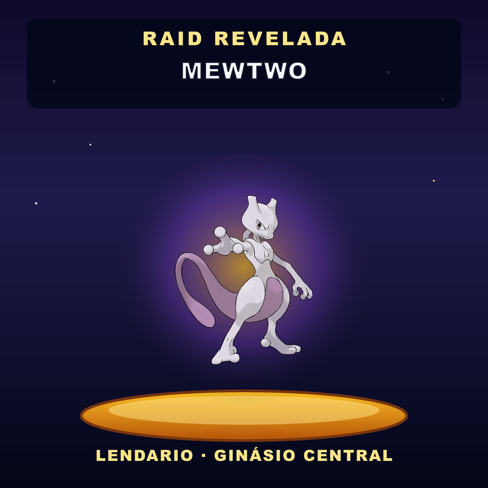

# Ready-for-GO — Cartões de revelação (`renderRaidOpenedReveal`)

**Decisão prep:** **READY FOR GO** · **cutover NÃO executado**  
**Produção permanece:** **12.7.3** (`5dc963c` / imagens `…1273-…b1d8cf14d3fb`)  
**Commit RC:** `c413d14bc2b98a8622abd5f3dc803d8536fe2bea`  
**Content hash:** `824a7c0548134266d26543998699a429fdf6f89b5c168fc21af344bf8894f8fc`  
**RC:** `/home/caiohclavico/odisseu-recovery/a6-fase-raid-reveal-rc-20261102T050642Z/`  
**Piloto:** `120363427684548487@g.us` · sem migration · sem alteração de agenda

---

## 1. Imagens RC (prontas, não implantadas)

| | Tag | Digest |
| --- | --- | --- |
| JVM | `odisseu-jvm:a6-raid-reveal-20261102T050642Z-824a7c054813-amd64` | `sha256:34a1b5d7029123683d262209e8fc3ed039efb61281cead20c3541722501e1b52` |
| Node | `odisseu-node:a6-raid-reveal-20261102T050642Z-824a7c054813-amd64` | `sha256:79a6ae27f7c857bcc57053a1f51d423f3eaacb8cdfe904469232082fbd7ec33f` |

Labels: `fase=raid-reveal` · `git-sha=c413d14…` · `content-hash=824a7c05…`

Rollback 12.7.3 registrado em `$RC/rollback/previous-versions.txt`:
- JVM `…1273-…b1d8cf14d3fb` · `sha256:3a9f0872…`
- Node `…1273-…b1d8cf14d3fb` · `sha256:4ed96ce4…`

---

## 2. Prévia dos cartões

### Ovo (T−30/15/5) — sem casinha


- Só ovo + plataforma + texto de countdown  
- Sem pilares/telhado  
- Sem nome/categoria/espécie do chefe  

### Revelação (`raid-opened`) — sprite do chefe



- Mesmo céu/plataforma/identidade visual  
- Sprite oficial no lugar do ovo  
- Banner: **RAID REVELADA** + nome  
- Rodapé: categoria · ginásio  
- Legenda WA = `format-opened` (dificuldade, HP, comandos)  
- Uma única mensagem (imagem + caption) — sem duplo envio  
- Fallback: só texto se sprite/render falhar  

Também em `$RC/preview/raid-revelada.png` e `$RC/smoke/raid-egg-*.png`.

---

## 3. Testes

| Suite | Resultado |
| --- | --- |
| `node --test test/pokemon-jvm-raid-egg-reminder.test.cjs` | **7/7** (ovos + `renderRaidOpenedReveal`) |
| `clojure -M:test-raid-auto-intent-fase1273` | **47 tests · 262 pass** (12.7.3 + 12.7.2/12.7.1) |
| `pokemon.tests.raid-opened-media-test` | **2/10 asserts** OK |
| PNG eggs na imagem Node | magic OK · tamanhos ~96–98KB |
| Módulo `renderRaidOpenedReveal` na imagem | presente |

---

## 4. Backups

| Tipo | Path | Manifest |
| --- | ---: | --- |
| Warm | `…/a6-periodic-backup-20261102T050642Z-warm-reveal` | `d3adcbd3…` |
| Cold | `…/a6-periodic-backup-20261102T050642Z-cold-reveal` | `9e04f0b8…` |

Agenda pós-backup **preservada** (sem PUT):

```
enabled=true intervalMs=3600000 dailyLimit=12 specialReserve=2
nextAt=1793599200000  # próximo slot (lendario planejado)
revision=4
lastSpawnId=raid-auto:…:1793595600000  # 1º spawn 01:00 CG já ocorreu
```

Live containers ainda **12.7.3**.

---

## 5. Plano de cutover (após GO definitivo)

1. Confirmar WA READY e `nextAt` atual.  
2. Backup compose → patch tags RC `a6-raid-reveal-…824a7c054813`.  
3. Recreate JVM → healthy → Node → READY.  
4. **Não** force tick · **não** migrate · **não** alterar schedule.  
5. Smoke:  
   - lembrete ovo ainda sem spoiler/casinha (próximo especial)  
   - próximo `raid-opened` com PNG revelação + 1 mensagem  
   - demais grupos OFF · leave ON · cap 12  
6. Se falha: recreate com imagens 12.7.3 do rollback.

---

## 6. Riscos residuais

| Risco | Mitigação |
| --- | --- |
| Download do sprite (rede) no reveal | fallback texto; cache em memória |
| PNG revelação ~250KB | aceitável no WA; ovos continuam ~97KB |
| Cutover no meio de janela T−30 | ovos já entram pela grace; reveal só no spawn |
| Intent/cadence leftovers | compatíveis com 12.7.3 no rollback |

---

## 7. Não feito (aguarda GO definitivo)

- Cutover / recreate de containers  
- Alteração de `nextAt` / cadence  
- Liberação de outros grupos  
- Migration schema  
