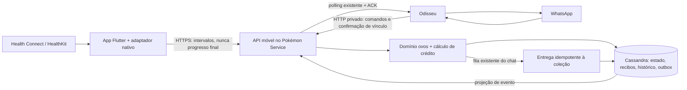

# Pokémon Adventure Sync — arquitetura proposta

Análise inicial em 10/10/2026, atualizada com a implementação local da Fase 2.
Integrações móveis descritas como **propostas** ainda não existem. Nenhum schema
foi instalado em produção; não existem API pública, app ou worker móvel.
Base examinada: checkout local do Zapbot, commit `5e8ff3b` (versão 0.20.0).
Não foram consultadas VMs, sessões WhatsApp ou dados de jogadores. Nenhum
repositório Flutter foi fornecido ou encontrado neste checkout.

Documentos relacionados: [dados](modelo-dados.md), [API](api.md),
[fases](plano-implementacao.md) e [segurança](riscos-e-seguranca.md).

## Decisões atualizadas — Fase 2 (10/10/2026)

O pedido desta fase substitui o planejamento anterior quanto a IVs e numeração:
**sem IVs novos**. A sincronização de passos foi abandonada: a proposta atual
usa tempo real ou pontos de atividades. A Etapa A contém apenas funções puras,
desligadas da persistência, para ovos comum/raro/épico e até três incubadoras.
Integração com captura, PvP, comandos e notificações permanece futura.

Implementação prevista no serviço existente: `ovos.cljs` será a autoridade de
tempo/pontos, `adventure_store.cljs` persistirá depois da Etapa B. A Etapa A
modela um slot permanente e até duas temporárias, até 9 ovos, sem IVs, XP ou
recompensas de captura. O catálogo existente será adaptado na integração.

`ADVENTURE_SYNC_ENABLED=false` é o padrão. Não existem comandos, rotas públicas,
Flutter, timers novos ou leitura de saúde. A Etapa A não faz consultas Cassandra.
Quando habilitado futuramente, schema e pendências de entrega serão
validados/reconciliados antes da prontidão; falha nessa etapa bloqueia readiness
para proteger o snapshot legado. Com a flag desligada, não se consultam tabelas
novas. Read-only não recupera/escreve nascimentos.

## 1. Inventário comprovado no código

Os links abaixo apontam para arquivos existentes, não para componentes futuros.

| Área | Evidência e comportamento atual |
|---|---|
| Odisseu | [core.cljs](../../src/zapbot/core.cljs) inicializa whatsapp-web.js/Node; [router.cljs](../../src/zapbot/router.cljs) encaminha comandos; [pokemon_http.cljs](../../src/zapbot/pokemon_http.cljs) constrói contexto e entrega respostas/eventos HTTP |
| Transporte | [pokemon-http-client.cjs](../../scripts/lib/pokemon-http-client.cjs), token de serviço, requestId, mídia por referência, polling e ACK de eventos |
| Serviço Pokémon | [main.cjs](../../pokemon-service/runtime/main.cjs), servidor HTTP Node; [service.cjs](../../pokemon-service/runtime/service.cjs), admissão, reservas, filas por chat e outbox; [entry.cljs](../../pokemon-service/src/pokemon_service/entry.cljs), fachada para o domínio ClojureScript |
| Domínio autoritativo | [core.cljs](../../pokemon-service/src/zapbot/pokemon/core.cljs), comandos, filas de jogadas e combates; a cópia em `src/zapbot/pokemon/` é legado e não será um segundo proprietário do Adventure Sync |
| Treinador | [treinador.cljs](../../pokemon-service/src/zapbot/pokemon/treinador.cljs), contas `{cid {pid conta}}`, coleção unificada em `equipe`, UUID `id-pokemon`, ativo por índice, enfermaria, XP, amizade e Pokédex |
| Loja/inventário | [loja.cljs](../../pokemon-service/src/zapbot/pokemon/loja.cljs), moedas e itens por chat/jogador, capacidade de mochila e coleção; ovos/incubadoras da Fase 2 usam estado separado, sem mudar a loja |
| Persistência | [armazenamento.cljs](../../pokemon-service/src/zapbot/armazenamento.cljs), JSON em `estado_particionado`, hidratação dos módulos registrados, filas por módulo, INSERT e reserva `IF NOT EXISTS`; não executa DDL no startup |
| Operações existentes | `!pk`/`!pokemon`, treinador, inicial, capturas/caçadas, golpes, cura, inventário/loja, evolução, ginásios, raids existentes, trocas/doações, professor, missões e PvP 1x1; consultar o [inventário de comandos](../pokemon-command-inventory.md) |
| Eventos/saúde | `/health`, `/ready`, `/commands`, `/events/pending`, `/events/{id}/ack`, `/media/{id}`; readiness requer hidratação e Cassandra conectado; health não atesta WhatsApp READY |
| Segurança existente | Bearer `API_TOKEN` entre serviços; comparação constante, limite de corpo 64 KiB, maxConcurrent, read-only e erros estruturados. Sem autenticação de jogador móvel, TLS nativo, vínculo de dispositivos ou rate limit de pareamento |
| Testes | Node `node:test` em `pokemon-service/test/*.test.cjs`; ClojureScript `cljs.test` em `pokemon-service/test/`; driver falso e fixtures de persistência, contrato HTTP, duplicidade, read-only e shutdown |

**Observação sobre documentos antigos:** `docs/pokemon-state-inventory.md` é um
levantamento anterior à extração. Suas referências a migração automática/DDL e
falhas absorvidas não descrevem o runtime atual do serviço. Prevalece o código
em `pokemon-service/src/zapbot/armazenamento.cljs`: falha de hidratação bloqueia
readiness; `aguardar-todas!` propaga falhas de durabilidade.

## 2. Adaptações necessárias antes da implementação

1. **Identidade tem escopo de grupo.** `playerId` não identifica sozinho uma
   coleção. Vincular um dispositivo ao par exato `(chatId, playerId)`, representado
   externamente por `accountId` opaco. Não juntar coleções de grupos nem normalizar
   `@lid` para `@c.us`. Trocar a conta-alvo exige desvinculação explícita.
2. **O Bearer do Odisseu não pode entrar no app.** Criar autenticação móvel e rotas
   próprias; preservar as rotas internas existentes. App não informa autor,
   grupo, admin ou comando arbitrário.
3. **Snapshot não equivale a transação entre módulos.** Novas tabelas consultadas
   por chave, CAS versionado e diário de operações são necessários. Não adicionar
   amostras de saúde ao cache global hidratado por `ALLOW FILTERING`.
4. **Há duas filas por chat hoje:** HTTP e domínio. A entrega de nascimento deve
   participar da fila autoritativa do domínio. Expor uma operação interna tipada
   que reutilize essa fila; não chamar `jogar` de dentro da mesma fila, causando
   espera circular. Manter um único escritor do snapshot legado `treinador`.
5. **IVs não existem na modelagem atual.** O combate usa stats suavizados e
   crescimento de 1,03 por nível. A decisão da Fase 2 é não introduzir IVs; manter o
   modelo atual sem substituir fórmulas existentes.
6. **WhatsApp não oferece transação com Cassandra.** Reaproveitar o consumidor
   HTTP e sua deduplicação, mas assumir entrega pelo menos uma vez e pequena
   janela de duplicação de mensagem após crash. Nascimento/coleção têm garantia
   independente de uma mensagem chegar.
7. **HTTPS público não está implementado no servidor Node examinado.** É preciso
   planejar domínio, certificado, término TLS e exposição apenas das rotas
   móveis. Esta é uma mudança futura justificada por clientes na internet;
   não será feita nesta fase nem requer trocar o destino de deploy.

Essas adaptações não justificam Kafka, outro servidor de jogo, migração de
contas antigas ou um segundo banco. Evoluir o serviço Pokémon HTTP existente.

## 3. Fluxo proposto

O app é coletor e interface de consentimento. O servidor decide distância
elegível, incubação, espécie, nível, capacidade e nascimento. API pública
não permite enviar Pokémon, atributos ou quilômetros prontos para um ovo.

## 4. Regras iniciais propostas, sujeitas à aprovação de balanceamento

| Regra | Proposta |
|---|---|
| Categorias | Ovos de 2.000, 5.000 e 10.000 metros |
| Inventário | Até 9 ovos, separado da mochila de itens e da capacidade de Pokémon |
| Origem inicial | 1 ovo gratuito de 2 km ao ativar a funcionalidade; concessão idempotente. Sem alterar recompensas atuais de missões/raids/loja nesta etapa |
| Incubadora | 1 permanente gratuita e 1 slot ativo no MVP; modelo admite incubadoras consumíveis com usos limitados depois, sem novo preço automático |
| Incubação | Só distância posterior à ativação, a partir do próximo intervalo completo. Progresso máximo é o objetivo; saldo excedente não vai para um próximo ovo ainda não ativado |
| Mais de uma incubadora | Futuramente cada incubadora ativa recebe a mesma caminhada elegível do período; não multiplicar o total pessoal nem reutilizar períodos anteriores à ativação |
| Estoque de Pokémon cheio | Resultado fixado em `delivery_pending`; após liberar vaga, a recuperação interna tenta entregar. `!pk ovos chocar` é comando futuro da Fase 3. Não descartar ovo/nascimento nem ultrapassar capacidade |
| Nível e HP | Nível 1, HP cheio, sem status e sem item equipado; mesmos conversores/stats/golpes válidos do domínio existente |
| IVs | Não implementados: usar exclusivamente o modelo atual, conforme decisão da Fase 2 |
| Shiny/raridade | Sem novo bônus shiny no MVP; raridade do catálogo de ovos é peso de sorteio, distinta da raridade calculada pelo jogo |
| XP/capturas | Chocar não incrementa sequência de captura nem concede XP/recompensas de captura. Registrar descoberta de espécie/nascimento sem chamar indiscriminadamente `registrar-captura!` |

Os registros atuais incluem nome, tipos, imagens, habilidade, stats, golpes,
nível, raridade, shiny, amizade e UUID. `pokemon->registro` não conserva campos
arbitrários: origem do ovo precisa de histórico por UUID e revisão explícita
dos conversores se forem também expostos na coleção. Evolução deve conservar
esse UUID e a referência à origem; nenhum atributo novo será adicionado.

### Catálogo inicial ilustrativo

Cada linha soma 100%. Sorteio em duas etapas: faixa de peso e espécie uniforme
dentro da faixa. Pesos por espécie poderão substituir essa uniformidade.
Os rótulos abaixo são **raridade de obtenção em ovos**, não classificação de
stats do combate. Validar disponibilidade/nome de cada espécie no catálogo local.

| Ovo | Comum | Incomum | Raro |
|---|---|---|---|
| 2 km | 70%: Pidgey, Rattata, Caterpie, Weedle | 25%: Bulbasaur, Charmander, Squirtle | 5%: Pichu, Cleffa, Igglybuff |
| 5 km | 55%: Geodude, Machop, Poliwag | 35%: Eevee, Growlithe, Vulpix | 10%: Togepi, Ralts, Mareep |
| 10 km | 40%: Onix, Scyther, Pinsir | 45%: Dratini, Larvitar, Bagon | 15%: Riolu, Gible, Beldum |

Sem lendários, míticos ou espécies fora do allowlist. Pesos, categorias,
nível e política shiny ficam em configuração versionada do domínio proposta
`egg-catalog-v1`. Fixar versão e entropia criptográfica privada ao conceder o
ovo; resultado só materializado ao atingir a meta. Persistir resultado antes
de entregar. Replay, atualização de catálogo ou falta de vaga não ressorteiam.
Dados essenciais de espécies/golpes devem estar preparados em catálogo/cache
validado, sem dependência obrigatória da PokéAPI para completar uma transação.

## 5. Saúde, dados incrementais e cálculo

### Adaptadores e plataforma

Candidato Flutter: pacote mantido [health](https://pub.dev/packages/health),
com suporte a HealthKit/Health Connect e tipos de passos/distância. Validar
num spike a versão, identificadores e cobertura nativa; não assumir que o plugin
implementa recuperação completa ou background iOS. [Platform channels do
Flutter](https://docs.flutter.dev/platform-integration/platform-channels)
permitem completar lacunas com Swift/Kotlin, sem outro backend.

| Plataforma | Leitura proposta | Restrições |
|---|---|---|
| Android | `StepsRecord`, opcional `DistanceRecord`, mudanças com token; agregação nativa por intervalo para passos | Health Connect deve estar disponível e conter dados; capacidades variam. Background precisa de permissão específica; histórico ampliado é separado |
| iOS | `stepCount`, opcional `distanceWalkingRunning`; UUID de amostra e `HKAnchoredObjectQuery` para alterações/exclusões | Consentimento por tipo; dados protegidos podem ficar inacessíveis com tela bloqueada; autorização de leitura negada pode parecer ausência de dados |

Não pedir GPS, escrita na saúde, batimentos, peso ou diagnósticos. Passos e
distância podem vir de sensores do sistema ou produtores autorizados; não
pressupor que Health Connect sempre gera passos sozinho em qualquer Android.
O SDK informa disponibilidade, e falta de dados deve ter orientação sem inventar
quilômetros. [Disponibilidade Android](https://developer.android.com/health-and-fitness/health-connect/availability).

O [Health Connect](https://developer.android.com/health-and-fitness/health-connect/read-data)
separa permissões de leitura, background e histórico. O MVP limita crédito a 7
dias de atraso e não pede histórico além do necessário. O app continua funcional
em primeiro plano se background for negado. Token de mudanças expirado demanda
releitura limitada e deduplicação, conforme [sincronização Android](https://developer.android.com/health-and-fitness/health-connect/sync-data).

No iOS, combinar [observer](https://developer.apple.com/documentation/healthkit/hkobserverquery)
com [consulta ancorada](https://developer.apple.com/documentation/healthkit/running-queries-with-swift-concurrency).
Guardar âncoras no dispositivo; UUIDs e exclusões atualizam o cache local.
Registrar e concluir callbacks de background rapidamente, após salvar trabalho
local, sem esperar rede indefinidamente. Dados criptografados podem estar
indisponíveis durante bloqueio, e leitura negada não é distinguível com certeza
de ausência de amostras. [Privacidade HealthKit](https://developer.apple.com/documentation/healthkit/protecting-user-privacy).

| Metadado local | Health Connect | HealthKit |
|---|---|---|
| Identidade da amostra | `metadata.id`, origem e tipo | UUID, source/sourceRevision e tipo |
| Alterações | Changes token, upsert/deletion; lastModifiedTime e clientRecordVersion quando fornecidos | Anchor por tipo/predicado, added samples e deleted objects; não inventar versão nativa numérica |
| Tempo | start/end e offset nativos, normalizados para UTC | startDate/endDate, normalizados para UTC |
| Cursor | Token salvo após página local durável; expiração leva a releitura limitada | Anchor salvo após página local durável; reinstalação leva a releitura limitada |

Esses cursores são locais, distintos de batchId, revision e watermark do
servidor. Amostras que cruzam slots devem usar agregação nativa consistente;
se for necessária repartição estimada, conservar o total inteiro com arredondamento
determinístico e registrar política de estimativa. Nunca copiar o total inteiro
para cada slot. Falha de permissão não envia zeros como se fossem exclusões.

### Unidade canônica, deduplicação e períodos offline

1. Adaptador normaliza leituras em intervalos UTC fixos de **5 minutos**,
   semiabertos `[start,end)`, alinhados ao relógio UTC. Usa totais substituíveis,
   nunca deltas aditivos do cliente. O app pode reler o mesmo intervalo.
2. UUID/ID, origem, versão, método de gravação e intervalo de amostras ficam
   preferencialmente no cache local. A identidade do intervalo enviado é
   `(accountId, collectionEpoch, start)`; amostras não são recontadas como
   eventos independentes. Hashes opacos de evidências são opcionais, sem nomes
   de aparelho/rotas. Mudanças/exclusões geram nova revisão do mesmo total.
3. Android: agregação de passos nativa considera prioridades de origens;
   `removeDuplicates` de objetos não resolve sobreposição de produtores.
   [Agregação Android](https://developer.android.com/health-and-fitness/health-connect/aggregate-data).
   iOS: spike deve verificar estatísticas agregadas e sobreposição iPhone/Watch;
   até comprovar equivalência, selecionar uma origem por intervalo e métrica,
   com regra estável, em vez de somar fontes sobrepostas.
4. Modo padrão do MVP: passos, com conversão **servidor** de 0,70 m/passo,
   versionada e assumidamente aproximada. Alternativa por epoch: metros de
   caminhada/corrida de origem permitida. `DistanceRecord` genérico Android
   pode incluir outros deslocamentos: usar passos se origem/modalidade não
   puder ser validada. Não somar distância medida com distância de passos.
5. Um dispositivo coletor e um modo por conta/epoch. Alteração de modo ou
   celular cria epoch com corte no próximo intervalo completo; períodos de
   epochs diferentes não se sobrepõem. Watch é origem local, não segundo coletor.
6. Aceitar só intervalos completos, posteriores à vinculação/corte e dentro de
   7 dias. Limites iniciais configuráveis: 40 km/dia UTC e 15 km/h equivalente
   por intervalo; excesso fica rejeitado/quarentenado, não creditado silenciosamente.
   Esses limites são política do jogo, não prova de caminhada nem recomendação física.
7. Reconciliar revisões durante 24 h após o fim do intervalo. Crédito provisório
   é exibível, mas não gera nascimento. Depois, na próxima sincronização/leitura
   ou recuperação, finalizar segundo os totais conhecidos. Não há exigência de
   novo timer de alta frequência. Dados offline inéditos de até 7 dias ainda
   podem entrar; intervalo já finalizado não ganha crédito adicional.
8. Correção posterior à finalização nunca retira Pokémon existente. Registrar
   divergência, acumular dívida de crédito se houve excesso e descontá-la de
   caminhada futura. A base corrigida fica versionada; restaurar depois o valor
   antigo não cria novo ganho. Detalhes no modelo de dados.
9. Janela de crédito é comparada ao relógio do servidor, não ao dia local nem ao
   contador do app. Atraso maior que 7 dias informa perda de elegibilidade, sem
   apagar progresso anterior. Horário de verão, fusos e reinstalação não zeram
   deduplicação no servidor.

Distribuir distância pela incubação válida **na hora da caminhada**, e não pelo
ovo ativo na hora do upload. Guardar intervalos de ativação/desativação. Caminhada
sem ovo ativo não vira saldo retroativo. Restringir mudanças de slot enquanto
houver resultado pronto não entregue; não consumir usos antes da confirmação.

### Execução eventual

Android: trabalho único periódico via WorkManager, rede disponível e permissão
de leitura em background quando suportada, mais sync ao abrir/retomar.
[Exemplo oficial](https://developer.android.com/codelabs/health-connect).
iOS: observer/background delivery com capability apropriada, mais sync ao abrir.
[Entitlement Apple](https://developer.apple.com/documentation/bundleresources/entitlements/com.apple.developer.healthkit.background-delivery).
Nenhum deles é serviço contínuo. Modo economia, bloqueio, encerramento pelo
usuário, falta de rede e quotas atrasam leituras/envios. O sistema operacional
pode registrar movimento bloqueado mesmo quando este app não consegue lê-lo.

## 6. Viabilidade e decisões de produto

A Apple orienta não solicitar HealthKit sem funcionalidade de saúde/fitness.
**Inferência para este projeto:** um complemento exclusivamente de jogo pode
não satisfazer essa finalidade. Antes de publicar, definir uma função real de
acompanhamento de caminhada, transparente e minimizada, e validar a adequação;
não prometer aprovação nem contornar a regra. [Orientação Apple](https://developer.apple.com/design/human-interface-guidelines/healthkit/).
Android também exige declaração de uso justificado no Play Console.
[Publicação Health Connect](https://developer.android.com/health-and-fitness/health-connect/publish).

Decisões pendentes de aprovação: distribuição de espécies, crédito com consolidação de 24 h, janela offline de 7 dias, conta por
grupo, aquisição de ovos após o primeiro, modo de distância e política de
correções. São valores propostos, não regras já instaladas.
